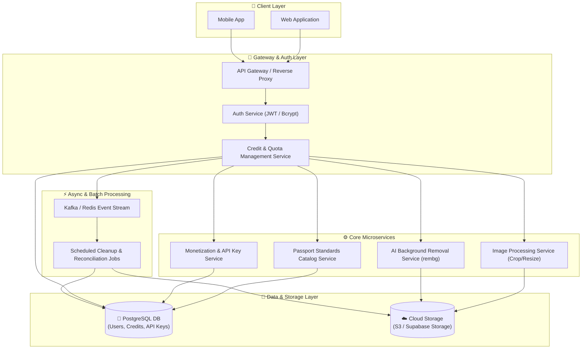
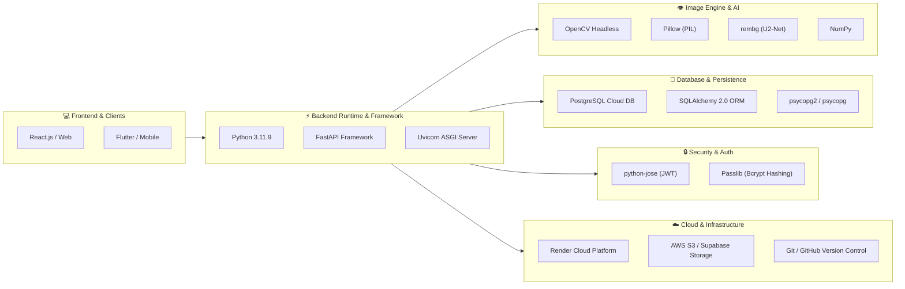

# 🖨️ PassPrint AI - Engine v3.0 (SME Print Optimizer)

ระบบวิเคราะห์ เพิ่มความละเอียดไฟล์พิมพ์ และจัดการผู้ใช้สำหรับธุรกิจ SME และร้านพิมพ์ออนไลน์ ด้วย AI และ Computer Vision ช่วยตรวจเช็กสเปกไฟล์เบื้องต้น (Pre-flight Analysis), ขยายความละเอียดภาพ 400% (4x Upscaling), เกลี่ย Noise และแปลงเป็นไฟล์ PDF ความละเอียด 300 DPI ที่พร้อมส่งโรงพิมพ์ได้ทันที

---

## 🌐 ระบบบริการและเอกสาร API (Application Links)

- **Web Application:** `http://localhost:8000`
- **Interactive API Documentation (Swagger UI):** `http://localhost:8000/docs`
- **ReDoc API Documentation:** `http://localhost:8000/redoc`
- **สไลด์:** `https://canva.link/7btqbrr35zko3px`

---

## ✨ ฟีเจอร์หลัก (Key Features)

- 🔑 **Authentication & User Management:** ระบบสมัครสมาชิก, เข้าสู่ระบบ, ออกจากระบบ, เปลี่ยนรหัสผ่าน และจัดการข้อมูลผู้ใช้ (CRUD Users)
- 📋 **Auto Pre-flight Analysis:** สแกนตรวจสอบมิติพิกเซล ประเมินความหนาแน่น DPI และโหมดสีของภาพเริ่มต้นอัตโนมัติก่อนส่งพิมพ์
- 🎨 **Smart AI Upscaling & Denoising:** 
  - ลดเม็ดบีบอัด/Noise ด้วย **Bilateral Filter**
  - ขยายข้อมูลภาพ 4 เท่าด้วย **INTER_LANCZOS4 Interpolation**
  - ปรับความสดและมิติสีบนระบบ **HSV Color Space**
  - ดึงขอบภาพให้คมนุ่มนวลด้วย **Unsharp Masking (Soft Sharpening)**
- 🖼️ **Interactive Before/After Slider:** เปรียบเทียบความแตกต่างระหว่างภาพต้นฉบับกับภาพที่ซ่อมแซมแล้วแบบเรียลไทม์
- 📄 **Print-Ready PDF Export:** แปลงภาพเป็นไฟล์ PDF ความละเอียดสูง (300 DPI Target) พร้อมส่งเข้าเครื่องพิมพ์
- 📂 **Cloud History Management:** เรียกดูรายการไฟล์ภาพ/PDF ที่ซ่อมแซมแล้วย้อนหลัง และจัดการลบไฟล์จากเซิร์ฟเวอร์ได้

---

## 🛠️ Tech Stack

- **Backend:** Python 3.12, FastAPI (v3.0.0), PostgreSQL, SQLAlchemy, OpenCV (`opencv-python-headless`), Pillow (PIL), NumPy, Uvicorn
- **Frontend:** HTML5, Tailwind CSS (via CDN), JavaScript (Vanilla ES6)
- **Containerization:** Docker, Docker Compose

---

## 🚀 วิธีการติดตั้งและรันใช้งาน (Getting Started)

### ออปชันที่ 1: รันด้วย Docker Compose (แนะนำ)

```bash
docker-compose up --build
```
ระบบจะทำการ Build Container ของทั้ง Web Application (FastAPI) และ Database Service (PostgreSQL) พร้อมเปิดให้บริการที่พอร์ต 8000 อัตโนมัติ

---

### ออปชันที่ 2: รันด้วย Python โดยตรง

1. **ติดตั้ง Dependencies:**
   ```bash
   pip install -r requirements.txt
   ```

2. **สั่งรันเซิร์ฟเวอร์ Backend:**
   ```bash
   uvicorn main:app --host 0.0.0.0 --port 8000
   ```

3. **เปิดใช้งานหน้าเว็บ:**
   เปิดเบราว์เซอร์ไปที่ `http://localhost:8000` หรือ `http://127.0.0.1:8000`

---

## 📡 REST API Documentation Overview

### 1. Pre-flight Analysis (สแกนวิเคราะห์ภาพ)
* **Endpoint:** `POST /analyze`
* **Content-Type:** `multipart/form-data`
* **Response Example (200 OK):**
  ```json
  {
    "status": "success",
    "issues": [
      "🔴 มิติภาพเริ่มต้นค่อนข้างเล็ก (600 x 450 px) เสี่ยงต่อการแตกเมื่อนำไปพิมพ์จริง",
      "🔴 ความหนาแน่นพิกเซลต่ำ (ประมาณ 72-150 DPI) จำเป็นต้องเกลี่ยและเพิ่มข้อมูลภาพ 400%",
      "✅ โครงสร้างสี RGB สมบูรณ์ พร้อมสำหรับอัลกอริทึมดึงรายละเอียดพิกเซล"
    ]
  }
  ```

---

### 2. Heal & Upscale Image (ซ่อมแซมภาพ & สร้าง PDF 300 DPI)
* **Endpoint:** `POST /heal` (หรือ `POST /process`)
* **Content-Type:** `multipart/form-data`
* **Response Example (200 OK):**
  ```json
  {
    "status": "success",
    "message": "repaired and upscaled successfully",
    "preview_url": "/fixed_files/healed_a1b2c3d4.png",
    "pdf_url": "/fixed_files/print_ready_a1b2c3d4.pdf",
    "original_resolution": "600 x 450 px",
    "healed_resolution": "2400 x 1800 px"
  }
  ```

---

### 3. Authentication & User Profile
* **POST `/register`** - สมัครสมาชิกใหม่
* **POST `/login`** - เข้าสู่ระบบและรับ Access Token
* **POST `/logout`** - ออกจากระบบ (Token Blacklist)
* **POST `/change-password`** - เปลี่ยนรหัสผ่าน
* **GET `/users/me`** - ดึงข้อมูลโปรไฟล์ผู้ใช้ปัจจุบัน

---

### 4. Image History Management
* **GET `/api/v1/images`** - ดึงรายการไฟล์ภาพและ PDF ทั้งหมดในระบบ
* **DELETE `/api/v1/images/{filename}`** - ลบไฟล์ผลลัพธ์ออกจากเซิร์ฟเวอร์

---

## 📂 โครงสร้างโฟลเดอร์โปรเจกต์ (Project Structure)

```text
.
├── fixed_files/          # โฟลเดอร์จัดเก็บไฟล์ภาพ PNG และ PDF ที่ประมวลผลแล้ว
├── Dockerfile            # คอนฟิกการสร้าง Docker Image (Python 3.12-slim)
├── docker-compose.yml    # คอนฟิกการรันบริการ Docker (FastAPI Web + PostgreSQL DB)
├── index.html            # โค้ด Frontend Single Page Application
├── main.py               # โค้ด Backend API Engine หลัก (FastAPI v3.0.0)
├── requirements.txt      # รายชื่อไลบรารี Python Dependencies
└── README.md             # เอกสารอธิบายรายละเอียดโปรเจกต์
```
## Microservices Architecture


## Technology stack diagram


## 📊 ความคืบหน้าโครงการ (Project Progress)

> **ภาพรวมความคืบหน้าทั้งหมด (Overall Progress): 75%**

| โมดูลงาน (Modules) | รายละเอียด (Tasks) | สถานะ (Status) | ความคืบหน้า (%) |
| :--- | :--- | :---: | :---: |
| **1. Environment & Setup** | กำหนด Python 3.11.9, Environment Variables และ Build Pipeline บน Render | ✅ เสร็จสิ้น | **100%** |
| **2. Database & Data Layer** | เชื่อมต่อ PostgreSQL Cloud ผ่าน SQLAlchemy 2.0 และจัดการ Driver `psycopg2` | ✅ เสร็จสิ้น | **100%** |
| **3. Security & Auth** | ระบบยืนยันตัวตน JWT Access Token และการเข้ารหัสรหัสผ่านด้วย `bcrypt` | ✅ เสร็จสิ้น | **90%** |
| **4. Core REST API** | โครงสร้าง FastAPI Endpoints, Swagger UI (`/docs`) และการจัดการ CORS Policy | ✅ เสร็จสิ้น | **85%** |
| **5. Image Processing Engine** | ระบบประมวลผลรูปภาพ OpenCV & Pillow (Crop, Resize, Alignment) | 🟡 กำลังพัฒนา | **70%** |
| **6. AI & Freemium System** | ระบบ AI ลบพื้นหลัง (`rembg`) และระบบ Credit-Based Quota (Free/Pro Tier) | 🟡 วาง Schema แล้ว | **30%** |
| **7. Cloud File Storage** | ย้ายการจัดเก็บรูปภาพความละเอียดสูงไปยัง Cloud Storage (AWS S3 / Supabase) | 🔴 วางแผนงาน | **20%** |

---

### 📈 รายละเอียดความคืบหน้าแยกตามฟีเจอร์หลัก

- [x] **Deployment & Stability (100%)** — แก้ปัญหา Dependencies และการปรับเวอร์ชัน Python บน Render เรียบร้อย ระบบขึ้นสถานะ Live
- [x] **Authentication & Database (95%)** — รองรับ Register, Login, JWT Token และการซิงค์ข้อมูลกับ PostgreSQL
- [o] **Passport & ID Image Processing (70%)** — รองรับการ Crop และปรับขนาดภาพตามพรีเซ็ตมาตรฐาน
- [o] **AI Background Removal & Color Swap (30%)** — ออกแบบ Logic Integration ร่วมกับ `rembg` และ Pillow
- [o] **Freemium & Credit Management (30%)** — ออกแบบ Schema สำหรับจำกัดโควต้าผู้ใช้ Free (5 เครดิต) และเปิดสิทธิ์ Unlimited สำหรับ Pro
