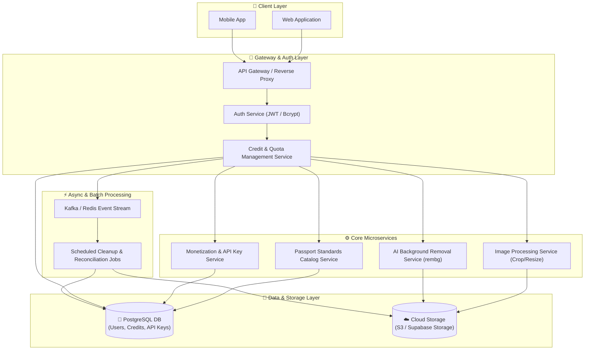

# 🎨 PassPrint AI - Single Page Print Fixer (Frontend Showcase)

🌐 **Live Demo (เข้าชมหน้าเว็บจริง):** https://67160330.github.io/ai_autofix/  
🏭 **กลุ่มอุตสาหกรรม:** กลุ่มอุตสาหกรรมการพิมพ์และบรรจุภัณฑ์

---

## 📌 ที่มาและปัญหาในอุตสาหกรรม (Problem Statement)
ในอุตสาหกรรมโรงพิมพ์และร้านสกรีน ปัญหาที่พบเจอเป็นประจำคือผู้ใช้/ลูกค้าส่งไฟล์ภาพความละเอียดต่ำ (Low DPI) หรือโลโก้ที่แคปหน้าจอมาสั่งพิมพ์ ส่งผลให้เมื่อนำไปพิมพ์ลงบนสิ่งพิมพ์จริง ภาพจะแตกเป็นพิกเซล และสีเพี้ยน โรงพิมพ์ต้องเสียเวลาในการปฏิเสธงานหรือขอไฟล์ใหม่ 

**PassPrint AI (Frontend)** ถูกออกแบบมาเพื่อแก้ปัญหานี้ โดยเป็นอินเทอร์เฟซที่ช่วยให้ผู้ใช้สแกนปัญหาไฟล์พิมพ์ และพรีวิวผลลัพธ์การขยายความละเอียดภาพ (Super-Resolution) ได้แบบเรียลไทม์ก่อนส่งเข้ากระบวนการพิมพ์จริง

---

## ✨ ฟังก์ชันเด่นในฝั่ง Frontend (Key Features)
1. **Single Page Application (SPA) Flow:** รวบรวมลำดับขั้นตอนการทำงาน 4 ขั้นตอน (อัปโหลด -> ตรวจ Pre-flight -> ประมวลผล -> ดาวน์โหลด) ไว้ในแดชบอร์ดเดียว
2. **Interactive Image Comparison Slider:** แถบเลื่อนรูดเปรียบเทียบภาพ Before (ต้นฉบับ) และ After (หลังซ่อม) เพื่อดูความคมชัดระดับพิกเซล
3. **Real-time Metadata Matrix:** แสดงข้อมูลมิติพิกเซล (Width x Height) เปรียบเทียบระหว่างไฟล์เดิมและไฟล์หลังซ่อมแซมเชิงตัวเลข
4. **Dynamic File Management:** ระบบจัดการไฟล์ที่สามารถกด "เปลี่ยนรูปใหม่" ได้โดยไม่ทำให้หน้าจอทับซ้อนกัน

---

## 🛠️ เทคโนโลยีที่ใช้ (Tech Stack)
* **HTML5 / JavaScript (ES6):** จัดการ DOM Events, Touch/Mouse Tracking Slider
* **Tailwind CSS (via CDN):** จัดเลย์เอาต์หน้าจอแบบ Modern Dark-mode Dashboard
* **GitHub Pages:** ใช้สำหรับ Deploy หน้าเว็บฝั่ง Frontend ให้สามารถใช้งานออนไลน์ได้ทันที

---

## 🚀 วิธีกดรันเพื่อตรวจโปรเจกต์ (How to Run)
1. สามารถเข้าใช้งานผ่าน **Live Demo** ได้ทันทีที่: https://67160330.github.io/ai_autofix/
2. หรือดาวน์โหลดไฟล์ `index.html` ไปเปิดบนเว็บเบราว์เซอร์ในเครื่องคอมพิวเตอร์ได้ทันทีโดยไม่ต้องติดตั้งแพ็กเกจเสริม

## Microservices Architecture


## Microservices Architecture

```mermaid

graph LR
    subgraph Layer1 ["💻 Frontend & Clients"]
        React["React.js / Web"]
        Flutter["Flutter / Mobile"]
    end

    subgraph Layer2 ["⚡ Backend Runtime & Framework"]
        Python["Python 3.11.9"]
        FastAPI["FastAPI Framework"]
        Uvicorn["Uvicorn ASGI Server"]
    end

    subgraph Layer3 ["👁️ Image Engine & AI"]
        OpenCV["OpenCV Headless"]
        Pillow["Pillow (PIL)"]
        Rembg["rembg (U2-Net)"]
        NumPy["NumPy"]
    end

    subgraph Layer4 ["🐘 Database & Persistence"]
        PostgreSQL["PostgreSQL Cloud DB"]
        SQLAlchemy["SQLAlchemy 2.0 ORM"]
        Psycopg["psycopg2 / psycopg"]
    end

    subgraph Layer5 ["🔒 Security & Auth"]
        JWT["python-jose (JWT)"]
        Bcrypt["Passlib (Bcrypt Hashing)"]
    end

    subgraph Layer6 ["☁️ Cloud & Infrastructure"]
        Render["Render Cloud Platform"]
        CloudStorage["AWS S3 / Supabase Storage"]
        Git["Git / GitHub Version Control"]
    end

    %% Relationships
    Layer1 --> Layer2
    Layer2 --> Layer3
    Layer2 --> Layer4
    Layer2 --> Layer5
    Layer2 --> Layer6
